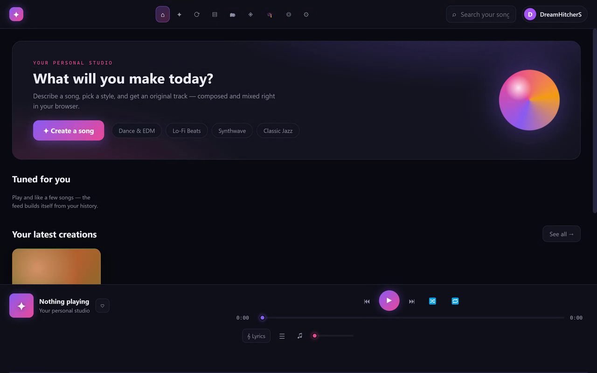
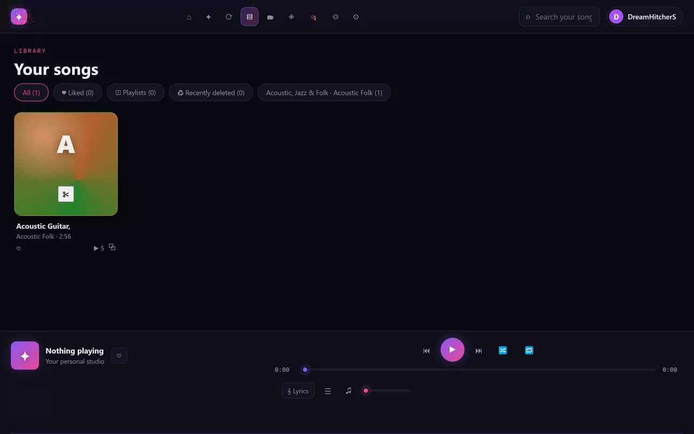
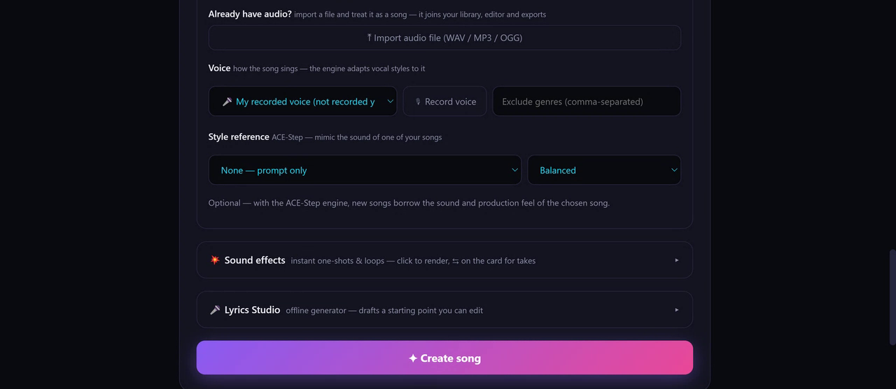

# ✦ MusicForStudio

[](https://github.com/dreamhitcher1980/MusicForStudio/actions/workflows/build.yml)

A private, family-oriented music studio that runs in your browser. Create original songs from a text description, sing them with your **own recorded voice**, remix any video link into music, and export to WAV / MP3 / MIDI / MP4 video — all with per-family-member libraries locked behind passcodes.

> **📦 Backup your library safely** — the app exports either one full backup file, or (Workspace → Backup & restore → *per-song splits*) one checksummed `.json` per song plus a small `_header` part, sized for version control and large libraries:
>
> 1. In the app: **Workspace → Backup & restore → ⭳ Backup as per-song splits**
> 2. Each part restores on its own via **⭱ Restore from backup** (per-song sha256 checksums are re-verified on import)
> 3. In this repo, [backup-splits/](backup-splits/README.md) holds a real split of an earlier backup; [merge-backup.cjs](merge-backup.cjs) reassembles and byte-verifies it (`node merge-backup.cjs --verify`) — the same check CI runs on every push

## Features

- **Song creation** — describe a song in your own words; the on-device engine seeds an original track from your prompt. Excluded genres, vocals (female / male / instrumental / your recorded voice), and AI-taste profiles are honored.
- **Your own voice** — record ~3 s with the mic (🎙 Record voice) and the engine resamples *your* timbre for lead vocals.
- **AI servers** — optional local backends: a MusicGen wrapper ([server/](server/), default `http://127.0.0.1:7860`) and ACE-Step (`http://127.0.0.1:8001`). Configure URLs in Settings → Local AI servers.
- **Video remix** — paste any video URL on the Remix view; the link becomes the seed (the video itself is never fetched).
- **Library & playlists** — categories, ♥ liked, playlists, ♫ recycle bin (30-day restore), per-member song counts.
- **Player** — shuffle, repeat (off/all/one), A/B compare between takes, play queue with drag-reorder and drag-from-library append, resume-where-you-left, Media Session integration (OS media keys/lockscreen), keyboard shortcuts (`space`, `←/→`, `N/P`, `M`, `L`, `C`, `Q`, `S`, `R`).
- **Exports** — WAV, MP3 (lame), MIDI, cover PNG, and an MP4 video export with a live canvas visualizer.
- **Accounts** — family members (owner: *DreamHitcherS*, default passcode `1234`) each with their own library, voice profile and settings. Deep-link everything: `#settings=engine`, `#learn=structure`, `#library=liked`, `#explore=<genre>`, `#queue=1`.

## Screenshots

**Home — describe a song and create it right in the browser**



**Library — your songs, playlists, likes, and the full-width player**



**Create — pick a style, sing with your own recorded voice, and hit ✦ Create song**



## Setup

```bash
npm install          # restore dependencies
node node_modules/esbuild/install.js   # needed: npm's allow-scripts policy blocks esbuild's postinstall
```

## Run

```bash
npm run dev          # Vite dev server → http://localhost:5173
npx vite build       # production build into dist/
```

### Optional: local AI generation server

The browser app creates songs fully on-device. For MusicGen-quality generation, run the bundled FastAPI wrapper (GPU strongly recommended, heavy model download on first start):

```bash
cd server
pip install -r requirements.txt
python musicgen_server.py            # serves /api/health + /api/generate on 127.0.0.1:7860
python musicgen_server.py --model facebook/musicgen-melody --port 7860   # options
```

Then in the app: **Settings → Local AI servers → Test connection**.

## Project layout

```
index.html          app shell (dialogs, footer player)
src/main.js         views, router, player wiring, queue, exports
src/family.js       member records, passcodes, sessions — all member policy
src/account.js      Account section inside Settings
src/gen.js          on-device generation engine (uses your voice profile)
src/voicerec.js     mic recording → vocal profile
src/player.js       <audio> wrapper
src/sfx.js          engine sound effects
src/ai.js           AI-taste/on-device model helpers
src/server.js       MusicGen / ACE-Step client
src/db.js           IndexedDB (songs, audio blobs)
src/lyrics.js, src/knowledge.js
server/musicgen_server.py   FastAPI MusicGen wrapper
```

State (settings, members, songs metadata) lives in `localStorage`/IndexedDB in your browser — nothing is sent anywhere except to the AI server you configure.

## CI

A GitHub Actions workflow builds the app on every push (`.github/workflows/build.yml`) — syntax checks plus `vite build`.
